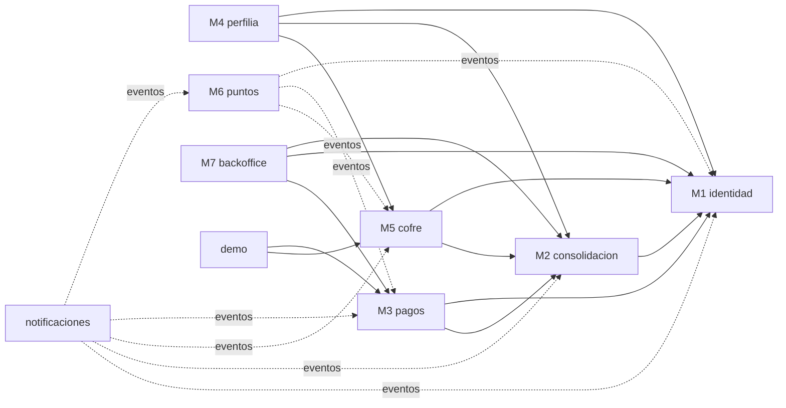

# Ahorra+ · Arquitectura del MVP

Este documento explica cómo el código implementa la arquitectura obligatoria del proyecto
(**monolito modular + hexagonal + Clean Architecture + DDD ligero**), cómo se corresponde con los
modelos C4 y con el modelo entidad-relación de Lucid, y dónde se garantiza cada regla de negocio.

---

## 1. Del C4 al código

| Contenedor C4 (nivel 2) | Implementación en el MVP | Dónde |
|---|---|---|
| App móvil Ahorra+ (Flutter) | App Flutter, Material 3, Riverpod + go_router | `mobile/ahorra_mas_app` |
| API Gateway (TLS, JWT, rate limit, Idempotency-Key) | Cadena de seguridad transversal: validación JWT, alcances por endpoint, `Idempotency-Key` obligatoria en pagos | `compartido/seguridad`, `pagos/adaptador/entrada/web` |
| Servicio de Identidad (Keycloak OIDC) | Módulo **M1 identidad**: PIN con BCrypt, dispositivos, OTP, step-up, tokens de vida corta (HS256). En producción se reemplaza por Keycloak (RS256) sin tocar los demás módulos | `identidad/` |
| Núcleo Ahorra+ (monolito modular) | Spring Boot 4.1 · Java 21 (CLAUDE.md exige Java; el C4 decía Kotlin) | `backend/` |
| Servicio de perfil de riesgo (IA, Python) | Módulo **M4 perfilia**: el clasificador es un servicio de dominio detrás de un puerto; el contenedor Python puede sustituirlo como adaptador | `perfilia/` |
| Hub de integraciones (ACL, timeouts, mTLS) | Adaptadores de salida HTTP de cada módulo + `HubIntegracionesConfig` (timeouts, huella de certificado cliente que simula mTLS) | `*/adaptador/salida/externos`, `compartido/integracion` |
| Worker de procesos (cola en PostgreSQL / outbox) | Adaptadores de entrada `programador` (`@Scheduled`) + **registro de publicaciones de eventos de Spring Modulith en PostgreSQL** (outbox: los eventos se guardan en la misma transacción y se reintentan) | `*/adaptador/entrada/programador`, tabla `event_publication` |
| Base de datos transaccional (PostgreSQL) | Un **esquema por módulo**: `identidad`, `consolidacion`, `pagos`, `perfilia`, `cofre`, `puntos`, `backoffice`, `notificaciones` | `backend/src/main/resources/db/migration` |
| Ledger de puntos (append-only) | Esquema `puntos` con triggers que impiden UPDATE/DELETE y trigger diferido de partida doble | `V7__puntos.sql` |
| Registro de auditoría (WORM) | `auditoria.evento` append-only con **cadena de hashes SHA-256** (cada evento sella al anterior) verificable desde el backoffice | `V1__…sql`, `compartido/auditoria` |
| Bóveda de secretos (Vault + KMS) | Esquema `boveda` aislado, contenido cifrado AES-256-GCM con llave propia; la BD del núcleo guarda solo la referencia | `consolidacion/adaptador/salida/externos/BovedaSecretosLocal` |
| Documentos KYC (objetos cifrados) | Almacén de objetos en disco cifrado; la BD guarda referencia + SHA-256 | `identidad/adaptador/salida/externos` |
| Backoffice web (React SPA) | SPA estática mínima (HTML + JS) servida por el núcleo en `/backoffice/` | `backend/src/main/resources/static/backoffice` |
| Sistemas externos (bancos, suiche, BCV, cripto, KYC, LLM, notificaciones) | **Simuladores en carpeta aparte** | `mocks/simuladores` |

## 2. Monolito modular

Cada paquete de primer nivel es un módulo de negocio (los módulos M1–M7 del E-R). **Spring Modulith**
verifica en cada build (`ArquitecturaTest`) que:

* un módulo solo usa de otro su paquete `api` (`@NamedInterface`), nunca sus clases internas;
* no hay dependencias cíclicas entre módulos.



`compartido` es el *kernel compartido* (módulo abierto): dinero/tasa, reloj, errores, auditoría,
cifrado, seguridad e integración. La documentación generada de módulos (PlantUML + canvases) queda en
`backend/target/spring-modulith-docs` al correr las pruebas.

### Comunicación entre módulos

* **Consultas síncronas** por interfaces del paquete `api` (p. ej. `TasasApi`, `CuentasApi`, `UsuariosApi`, `CofreApi`, `PagosApi`).
* **Eventos de dominio** persistidos (outbox) y consumidos con `@ApplicationModuleListener` (asíncronos, transaccionales, reintentables):

| Evento | Publica | Consumen |
|---|---|---|
| `UsuarioRegistrado` | identidad | puntos (abre cuenta y nivel Base) |
| `KycResuelto`, `DispositivoRegistrado/Revocado`, `OtpEnviado` | identidad | notificaciones, backoffice (alerta AML por listas) |
| `MovimientoRegistrado` | consolidacion | **cofre (reglas de ahorro automático)**, notificaciones |
| `ConsentimientoActivado/Revocado` | consolidacion | notificaciones |
| `AporteRegistrado`, `MetaCumplida` | cofre | puntos, notificaciones |
| `SelloRoto`, `ColchonUsado`, `RachaCerrada` | cofre | notificaciones |
| `PagoSolicitado` | pagos | backoffice (monitoreo AML) |
| `PagoEstadoCambiado` | pagos | notificaciones |
| `PagoCapturado` | pagos | puntos (pago puntual, financiado por el banco aliado) |
| `DiferenciaConciliacion` | pagos | backoffice (abre caso) |
| `PuntosAcreditados`, `NivelAlcanzado` | puntos | notificaciones |

## 3. Hexagonal dentro de cada módulo

```
<modulo>/
├── api/                      ← puerto público para otros módulos (interfaces + eventos)
├── dominio/                  ← modelo puro: agregados, objetos valor, servicios de dominio (sin Spring)
├── aplicacion/
│   ├── puerto/entrada/       ← casos de uso (interfaces)
│   ├── puerto/salida/        ← repositorios y sistemas externos (interfaces)
│   └── Servicio*.java        ← implementación de los casos de uso (transacciones, orquestación)
└── adaptador/
    ├── entrada/web|eventos|programador   ← REST, oyentes de eventos, worker
    └── salida/persistencia|externos      ← JDBC (PostgreSQL), HTTP (simuladores), bóveda, almacén
```

Reglas verificadas con **ArchUnit** en `ArquitecturaTest`:

1. `dominio` no depende de Spring, Jakarta, JDBC, Jackson, `aplicacion`, `adaptador` ni infraestructura.
2. `aplicacion` no depende de `adaptador`.
3. Los adaptadores de entrada no usan los de salida.
4. **R-01**: ningún campo del dominio es `double`/`float`.

La prueba de que los puertos funcionan: las pruebas de integración sustituyen todos los adaptadores
HTTP por dobles en proceso (`SistemasExternosFalsos`) sin cambiar una línea del núcleo.

**Decisión — JDBC explícito (`JdbcClient`) en vez de JPA**: el modelo de dominio son *records*
inmutables, los ledgers son append-only y las consultas usan bloqueos (`FOR UPDATE`, *advisory
locks*), `ON CONFLICT` e índices parciales. SQL explícito hace visibles esas garantías.

## 4. Dinero y tasa BCV

* Montos **siempre** en céntimos `long`/`BIGINT` con moneda explícita (R-01). La app tampoco usa flotantes.
* Tasa BCV como `valorBsX10000` fechada (R-07); conversión con aritmética entera (`BigInteger`) y
  redondeo **HALF_UP** al céntimo (`TasaBcv`).
* Porcentajes en puntos básicos (10 000 = 100 %), multiplicadores ×100.

## 5. Reglas de integridad del E-R (R-01 … R-23)

| Regla | Dónde se garantiza |
|---|---|
| R-01 montos enteros | Tipos `BIGINT` + dominio (`TasaBcv`, `Montos`) + ArchUnit |
| R-02 sin claves ni PAN | No existen columnas para ello; token en `boveda.secreto` cifrado; tarjeta = alias + últimos 4 (`CHECK ~ '^[0-9]{4}$'`) |
| R-03 un consentimiento activo; débito solo bancos | Índice único parcial `consentimiento_activo_uk`; `Consentimiento.solicitar` |
| R-04 alianza/tarjeta solo BANCO; cripto solo lectura | FK compuesta `(id_institucion, tipo='banco')`; `CuentaConSaldo.soloLecturaPara` |
| R-05 históricos con un vigente | `CHECK fecha_fin > fecha_inicio` + índices únicos parciales `WHERE fecha_fin IS NULL` |
| R-06 mayor de edad, únicos, PII cifrada | `CHECK` de edad, `UNIQUE` sobre índices ciegos HMAC, AES-GCM en el adaptador |
| R-07 tasa única por moneda/fecha | `UNIQUE (id_moneda, fecha_vigencia)`; cada aporte guarda la tasa usada |
| R-08 meta en USD, acumulado calculado | `CHECK fecha_objetivo > fecha_creacion`; acumulado = Σ ledger (`Aporte.acumulado`) |
| R-09 cuota del día | `RutaDelDia` (dominio) + `UNIQUE (id_meta, fecha)` |
| R-10 ledgers append-only | Triggers `impedir_modificacion` en `aporte`, `transaccion_puntos`, `asiento_puntos`, `historial_estado_pago`, `mensaje_suiche`, `reporte_mensual`, `auditoria.evento` |
| R-11 racha y colchón | Índice único de racha activa + `Racha.evaluarDia` |
| R-12 sello | `SelloCompromiso.sellar/seRompeCon`; romperlo cierra la racha |
| R-13 regla con aprobación | `fecha_aprobacion NOT NULL`, `CHECK` de subtipo, step-up PIN, FK a la recomendación aceptada |
| R-14 estados del pago + historial | `EstadoPago` (máquina de estados) + `CHECK` + historial inmutable en cada transición |
| R-15 idempotencia | `UNIQUE clave_idempotencia` + `INSERT … ON CONFLICT DO NOTHING`; ante timeout se consulta con la misma referencia |
| R-16 controles del pago | Consentimiento con débito, `CHECK beneficiario_confirmado`, step-up PIN+OTP, límite diario con *advisory lock* por usuario, antifraude de velocidad |
| R-17 comisión única | Calculada al crear el pago; no se cobra si es rechazado/reversado |
| R-18 puntualidad | `PagoTdc.capturado` compara con `fecha_limite_pago`; solo entonces puntos del banco aliado |
| R-19 conciliación | `Conciliador` (dominio) + `CHECK (id_pago IS NOT NULL OR linea IS NOT NULL)`; prueba OE4 |
| R-20 arco exclusivo de cuentas de puntos | `CHECK cuenta_puntos_arco_ck` + índices únicos por dueño |
| R-21 partida doble | `TransaccionPuntos` (dominio) + *constraint trigger* diferido en BD |
| R-22 canje | `Niveles.validarCanje` (saldo, nivel, stock, vigencia) |
| R-23 distribución = 100 %, IA seudonimizada | *Constraint trigger* diferido; el LLM recibe solo `idSeudonimo` y rangos (el simulador rechaza PII con 422) |

## 6. Flujos

* **F1 Vinculación**: selección múltiple → un consentimiento por banco (alcance mínimo) → la app abre
  la banca del simulador (el usuario escribe su clave allí) → `callback` → canje del código por token
  (mTLS simulado) → bóveda → sincronización → posición global.
* **F2 Pago de TDC**: beneficiario confirmado por el suiche → step-up PIN + OTP → `PENDIENTE`
  (idempotente) → autorización (timeout configurable) → captura → `CAPTURADO` → conciliación diaria.
  Excepciones: timeout → `EN_VERIFICACION` → consulta con la misma referencia (worker cada 30 s);
  rechazo → sin débito ni comisión; captura rechazada → reverso de la autorización; diferencia en la
  conciliación → `CON_DIFERENCIA` → reverso → caso en backoffice → aviso al usuario.
* **F3 Saldo rápido**: token `saldo:leer` ligado al dispositivo (huella) que no sirve para nada más;
  3 PIN fallidos, robo o revocación anulan sesión y token.
* **F4 IA explicable**: rasgos seudonimizados → reglas versionadas → LLM solo redacta → la regla
  sugerida se crea **solo** si el usuario acepta con PIN → todo queda en auditoría (versión, rasgos, decisión).

### Cofre Protector (módulo nuevo)

| Engranaje | Implementación |
|---|---|
| Ruta del día | `RutaDelDia`: ⌈(objetivo − acumulado) / periodos restantes⌉ a la tasa BCV del día, fijada una vez por periodo (diaria o semanal). Aporte en un toque (`origen = cuota_del_dia`) |
| Racha con días colchón | `Racha` + cierre diario del worker: día sin aporte → colchón (2–5 por mes según tramo); sin colchones → la racha se cierra. Tramos ×1,0 / ×1,25 / ×1,5 / ×2,0 multiplican los Puntos Ahorro |
| Espejo de Impacto | `EspejoImpacto`: Σ usdᵢ × (tasaFin − tasaRefᵢ) con el ledger inmutable y la tasa BCV; frase y disclaimer; se congela una vez en `REPORTE_MENSUAL` al cerrar el mes |
| Sello de compromiso | `SelloCompromiso`: lógico; un retiro que toca lo sellado antes de la fecha lo rompe y cierra la racha (pierde el multiplicador, nunca dinero) |

Las **reglas de ahorro automático** (porcentaje de ingreso, redondeo, fijo quincenal) reaccionan a
`MovimientoRegistrado` y son idempotentes por `clave_origen` (un movimiento nunca aporta dos veces).

## 7. Pruebas

| Tipo | Qué cubre |
|---|---|
| Arquitectura | Spring Modulith (límites/ciclos) + ArchUnit (capas, R-01) + documentación de módulos |
| Dominio (unitarias) | Tasa y redondeo, cuotas R-09, racha/colchón R-11, sello R-12, Espejo, reglas R-13, máquina de estados R-14, comisión R-17, puntualidad R-18, conciliación R-19, partida doble R-21, canje R-22, IA R-23, AML |
| Integración | App completa sobre PostgreSQL real embebido + HTTP real: F1, F3, Cofre de punta a punta, F2 con todos los escenarios, IA, backoffice/AML, inmutabilidad y auditoría |
| **OE4** | `Oe4ConciliacionIntegracionTest`: 500 transacciones (con timeouts, rechazos, capturas rechazadas, diferencias y faltantes, y reintentos con la misma clave) → **100 % conciliado, cero duplicados** |
| E2E | `scripts/prueba_e2e.py` contra núcleo + simuladores reales (incluye verificación del hash SHA-256 del archivo de liquidación) |

## 8. Limitaciones conocidas del MVP

* Identidad local (PIN + JWT HS256) en lugar de Keycloak; biometría delegada al teléfono.
* mTLS simulado con una cabecera de huella de certificado; bóveda y almacén de objetos locales cifrados.
* El worker corre dentro del mismo despliegue (se puede separar con `ahorra.worker.habilitado`).
* El backoffice es una SPA mínima sin MFA ni VPN; operadores demo con clave `demo`.
* Los umbrales AML, antifraude y la serie BCV/inflación del simulador son ilustrativos.
* Sin autorización SUDEBAN: el MVP no opera con dinero ni usuarios reales.
